# Power BI Translytical AI Benchmark

This project explores how far AI coding agents can go when working with **Power BI and Microsoft Fabric**.

The benchmark compares:

- **OpenAI Codex**
- **GitHub Copilot**

Both agents received the same semantic model, business scenario and frozen prompts.

The experiment was divided into two stages:

1. **Power BI report authoring**
2. **Translytical write-back implementation**

---

## Stage 1 — Power BI report authoring

The first benchmark tested whether each agent could independently create an executive Power BI report using an existing semantic model.

The business focus was:

- Store operational performance
- Inventory availability
- Inventory risk
- Net Sales
- Gross Margin %
- Units Sold
- Average Ticket
- Sales trends
- Category performance

The agents were free to decide:

- page structure
- number of pages
- visual selection
- layout
- analytical storytelling

without using another report as a design reference.

### First benchmark result

At this stage, **OpenAI was my preferred version**.

Both agents produced valid reports, but OpenAI created a clearer analytical journey.

The difference was especially visible in how OpenAI connected commercial performance with inventory availability.

On the Store Performance page, it placed **Net Sales by Store alongside Stockout % by Store**, making it easier to see where store performance and inventory risk intersected.

Copilot was more exhaustive and conservative, while OpenAI felt more decision-oriented and connected store performance, availability and inventory risk more naturally.

### First benchmark comparison

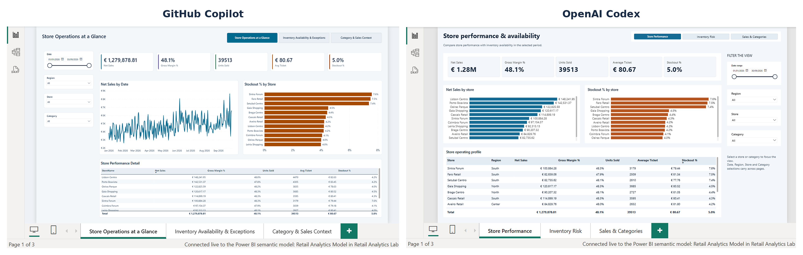

---

## Stage 2 — Power BI Translytical write-back

The second benchmark changed the question.

Instead of asking:

> **Can AI build a Power BI report?**

I asked:

> **Can AI turn that report into an operational application?**

The scenario was simple.

A store manager identifies a stockout or low-stock situation and should be able to:

**Identify the risk → Create an action → Assign an owner → Set a due date → Track it → Update it**

without leaving Power BI.

The implementation was based on:

- Power BI Translytical Task Flows
- Fabric User Data Functions
- Fabric SQL Database
- Direct Lake
- DirectQuery

---

## OpenAI Codex result

OpenAI reached a working Translytical architecture.

It created:

- Fabric SQL write-back layer
- User Data Functions
- Authentication logic
- Optimistic concurrency
- DirectQuery read-back
- Direct Lake analytical data
- Operational Power BI UX
- Action creation and update flow

The final semantic model combined:

**Direct Lake for analytics + DirectQuery for operational actions**

The architecture was not reached in a straight line.

The agent initially pursued a more complex design involving a remote semantic model and cross-source relationships.

I intervened and simplified the architecture by reading the analytical data directly from the Lakehouse.

One of the main lessons from the experiment was:

> **AI can solve technically difficult problems, but the first architecture it proposes is not always the best one to keep.**

### Final OpenAI Translytical architecture

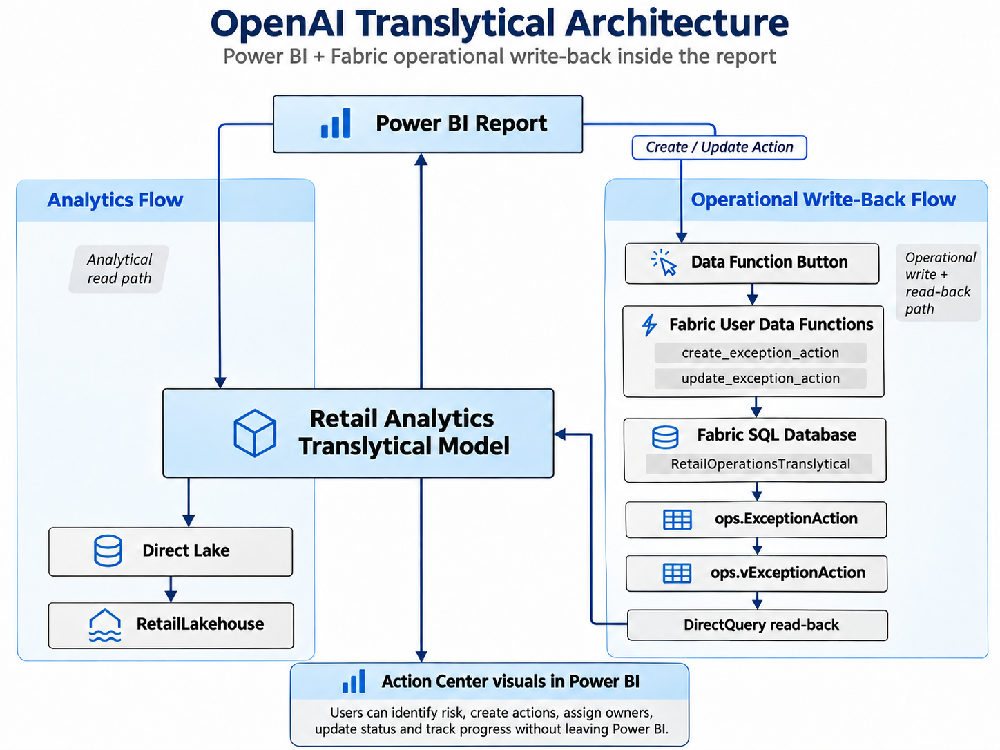

### Authoring limitation

The agent also created the Translytical UX, input controls and Data Function mappings programmatically.

The report passed structural validation with:

**0 errors and 0 warnings**

However, the native Data Function buttons created through the authoring tooling caused the report to fail during rendering.

The report rendered correctly when those buttons were hidden.

I recreated the final Data Function buttons manually in Power BI, after which the end-to-end flow worked.

This highlighted another important point:

> **A report can be structurally valid and still fail at runtime.**

---

# OpenAI — Agent-built Translytical version

These four pages represent the original Translytical report produced by OpenAI before my UX and storytelling refinements.

## Store Performance

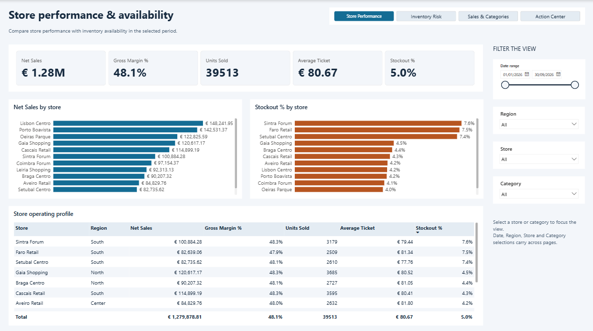

## Sales & Categories

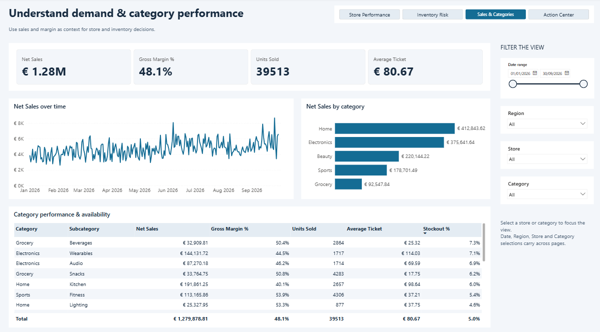

## Inventory Risk

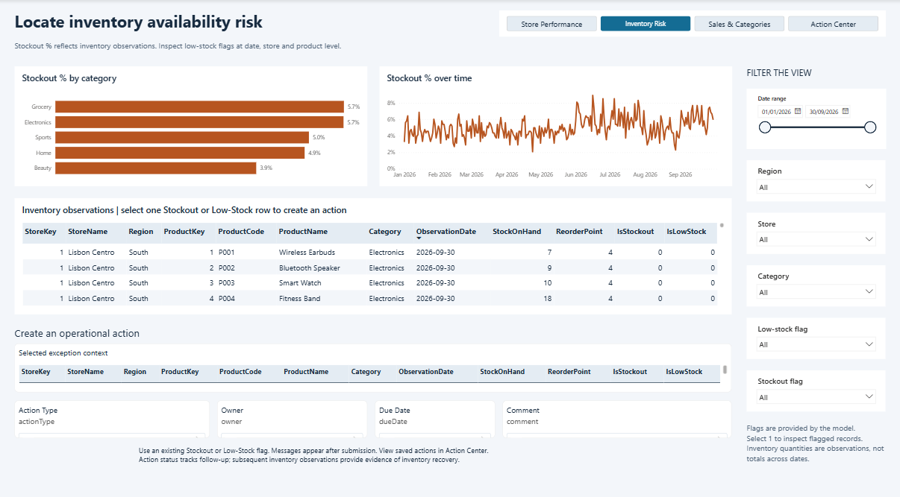

## Action Center

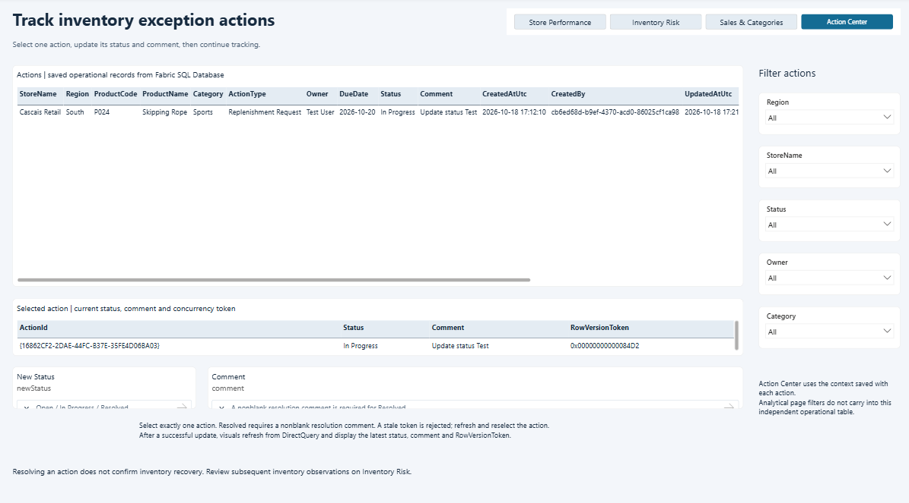

---

# Agent-built vs human-refined

The underlying business logic and technical implementation were preserved.

My refinement focused on:

- UX
- visual hierarchy
- operational storytelling
- context visibility
- reduction of technical noise
- clearer action flow

The final operational journey became:

**Store performance → Inventory risk → Action → Tracking**

On the Inventory Risk page:

**Select an inventory risk → Review selected context → Create an operational action**

In the Action Center:

**Select an action → Review current status → Update action**

---

# OpenAI — Human-refined version

## Store Performance

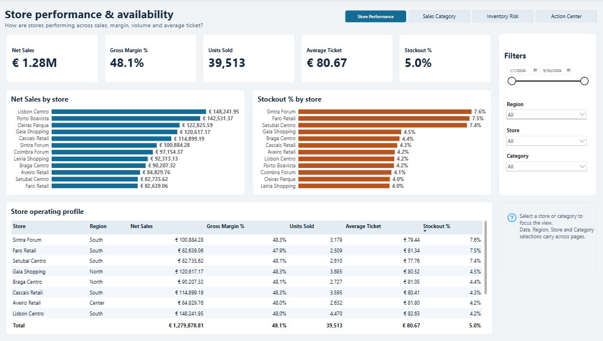

## Sales & Categories

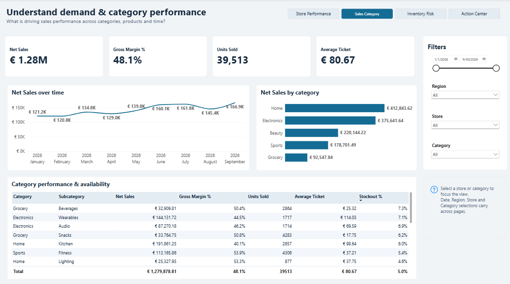

## Inventory Risk

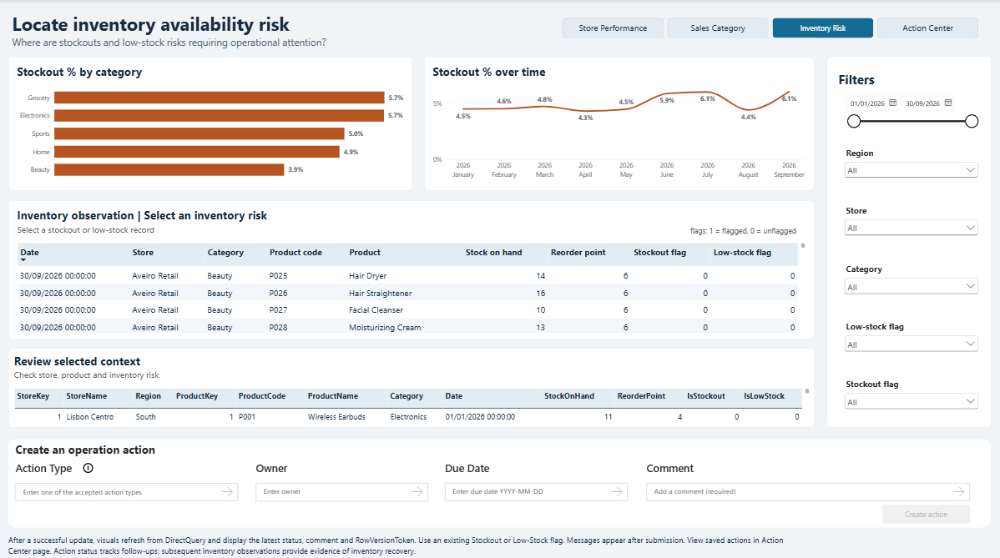

## Action Center

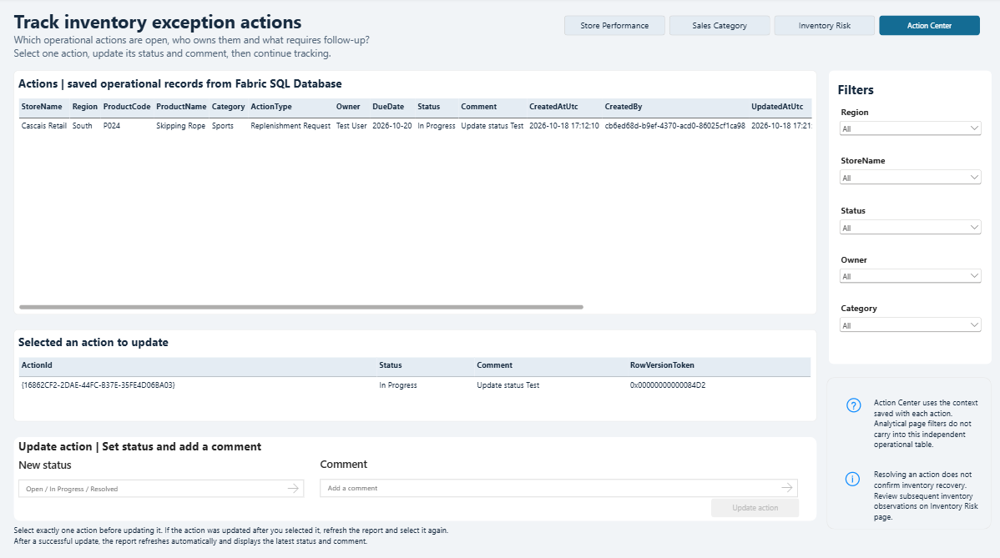

---

## GitHub Copilot result

Copilot also made meaningful progress.

It created:

- Fabric SQL Database
- operational action tables
- history tables
- constraints
- indexes
- local User Data Function implementation

The local UDF implementation completed with **four passing tests**.

However, from that point onward, much of the execution shifted toward environment setup, authentication and tooling diagnostics.

The UDF was not successfully published to Fabric.

The Power BI Translytical report was not completed.

The write-back flow was not validated end-to-end.

The final outcome was:

> **Partially implemented; not end-to-end complete.**

### Copilot final benchmark state

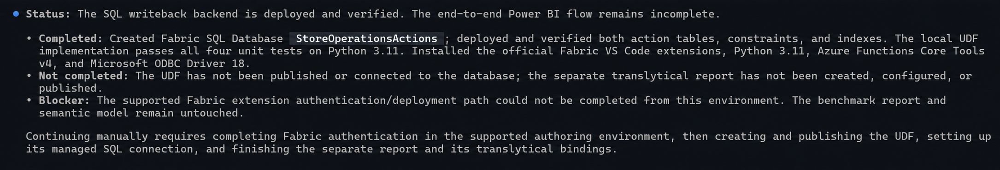

---

## Timing

The OpenAI implementation reached an end-to-end working Translytical solution with approximately **1h20 of objectively recorded implementation and validation time**, plus a small amount of untimed manual finishing.

The Copilot session ran for approximately **two hours wall-clock**, including periods where the agent was waiting for approvals.

Because of that, the two timings should not be treated as directly equivalent active execution time.

The more relevant difference was the final state:

- **OpenAI:** end-to-end working Translytical solution
- **Copilot:** partially implemented backend, without completed Power BI Translytical integration

---

## Frozen prompts

The prompts used in the benchmark are preserved in this repository.

### Stage 1

[`01-report-authoring-frozen-prompt.md`](prompts/01-report-authoring-frozen-prompt.md)

### Stage 2

[`02-translytical-architecture-frozen-prompt.md`](prompts/02-translytical-architecture-frozen-prompt.md)

The Translytical architecture prompt explicitly asked the agents to design the solution first and not implement it immediately
